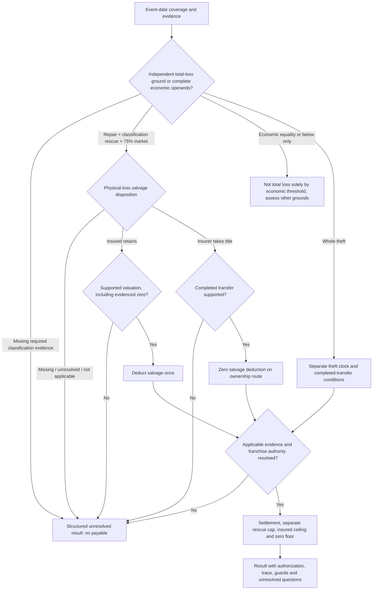

# Article 19 total-loss acceptance review

Review date: 2026-11-01 (Asia/Tehran). **Broader release BLOCKED.**

## Baseline and boundaries

Original user worktree `F:/Git/body model` was preserved. Work is isolated in `F:/Git/body-model-article19`, branch `codex/article19-acceptance`, Python 3.11.4. Parent: `cd7fb39a0b7859f2cec91b94770e240ab62e0b75` (PR #48 head). GitHub read-only inspection found #48, #57, #58 and #59 OPEN and unmerged. #58 head `49b2446f4ac2674f5bbbd81b5d3bc513e1e77133` and #59 head `1e41c67c7f892526f52aecd40267709592383444` were cherry-picked locally, followed by the seven PR #57 evidence commits ending at `cb7bce78e8704378539f915f5d4ffd9be943a597`. No remote merge, issue closure, or release approval occurred.

The #58/#59 integration conflict was confined to the generated mutation report. The combined mutation definitions retain final-branch M30 and title-transfer M31, retire equivalent M29 as #58 documents, and add M32/M33 for salvage completeness. The report was regenerated. Knowledge/schema/fixture formulas were not changed. Knowledge revision is the parent graph content; execution uses its event-date snapshot, recorded in each result. Source data quality is separate from engine determinism.

Reviewed runtime candidate: `598e37023b0462ccb765fad2007b8577ea96c355`. Knowledge Git tree: `770d11cd4a016b8e7173b896cd28f360f5f52527`. Verification outcomes are recorded in the evidence files below; no historical result is substituted for a fresh run. Intermediate failed runs are retained as diagnostic evidence and are superseded only by explicitly named final evidence. Test setup changes explicitly supply retained salvage with synthetic zero in old settlement-positive tests that previously omitted it; their expected payables were preserved. These are assumptions of arithmetic controls, not documentary proof of zero salvage.

## A. Legal claim-to-source matrix

Primary government publication located through the national legislation portal: [Regulation 53 consolidated text](https://qavanin.ir/Law/TreeText/?IDS=12020232825033491345), [metadata](https://qavanin.ir/Law/Attribute/?IDS=12020232825033491345), [consolidation status](https://qavanin.ir/Law/StatusIndex/?IDS=12020232825033491345), [related instruments](https://qavanin.ir/Law/RelatedIndex/?IDS=12020232825033491345). Issuer: شورای عالی بیمه. Approval: 1384/12/09; notification 32010, 1384/12/23, رئیس شورای عالی بیمه. Portal status: معتبر. Publication date and official-gazette fields are blank; execution date displays `0000/00/00`. Do not equate the approval date with a verified effective date.

Preserved rendered text and metadata: `article19-evidence/qavanin-reg53-{rendered,metadata,status,related}.txt`. These are browser captures of an official publication, not signed originals; SHA-256 identities are in `artifact-sha256.json`. The status page showed no populated amendment rows; this is not proof that no amendments exist. Related instruments include a 1402/11/17 decision concerning Art. 6(1), outside this bounded calculation review. Claim-date amendment completeness remains a domain/source-review item.

| Proposition | Exact Persian wording / locator | Classification | Applicability and decision |
|---|---|---|---|
| Strict economic threshold includes rescue | Art. 19, الف: «مجموع هزينه هاي تعمير و تعويض قسمتهاي خسارت ديده آن با احتساب هزينه هاي نجات از 75 درصد قيمت آن در روز حادثه بيشتر باشد» | Explicit | Strict `>`; equality does not satisfy this economic ground. This alone does not dispose of independent total-loss grounds, including whole theft. Event-date applicability pending. |
| Total-loss valuation and salvage deduction | Art. 19 الف, تبصره 1: «ارزش معاملاتي موضوع بيمه در روز حادثه و حداكثر تا مبلغ بيمه شده» and «ارزش بازيافتي احتمالي و كسورات مقرر كسر» | Explicit principle | Supports event-value/insured limit and salvage deduction; applicable franchise and exact contractual ordering still require authority. |
| Insurer takes ownership after salvage-value disagreement | Art. 19 الف, تبصره 2: «در صورت عدم موافقت بيمه‌ گذار با ارزش تعيين شده، بيمه‌گر پس از تملك موضوع بيمه و انتقال سند» | Explicit for specified route | Completed transfer required on the modeled completed-ownership route. Extension to a consensual insurer-title route is a safety/evidence invariant requiring applicable agreement, not a claim every physical total loss requires transfer. |
| Whole-theft transfer | Art. 19 الف, تبصره 4: «قبل از پرداخت خسارت مربوط به سرقت كلي موضوع بيمه، سند مالكيت وسيله نقليه بيمه شده بايد به بيمه‌گر منتقل شود» | Explicit and separate | Whole theft keeps its own transfer and timing conditions; physical-wreck completeness must not block its established transfer route. |
| Rescue reimbursement ceiling | Art. 4: «حداكثر تا بيست درصد كل خسارت وارده قابل جبران خواهد بود» | Explicit ceiling; denominator mapping unresolved | Reasonable rescue/prevention/transport costs are bounded; wording does not authenticate every engine denominator. No rescue formula was changed. |
| Classification rescue vs settlement rescue | Art. 19 الف economic test vs تبصره 1 and Art. 4 | Separate legal uses; exact scope interaction unresolved | Preserve distinct operands. Conflicting actual/classification amounts or embedded rescue require decomposition/authority; do not silently choose a financial interpretation. |
| Franchise | Art. 2(6): «ميزان آن در بيمه‌نامه مشخص مي‌گردد» | Contractual amount | S05's absolute 100 is a synthetic regression assumption only. |
| Salvage-before-franchise circular | Repository identifies circular 1400/401/146850, purported 1400/09/13, compilation `https://centinsur.ir/_douranportal/documents/2277/carinsurance.pdf` | AUTHORITY_PENDING | Both issuer homepage and exact compilation URL returned 403 Access Denied in Playwright. No original wording, page locator, publication/effective-date authentication or original-file hash obtained. Existing graph metadata is not independent verification. |

## B. Calculation flowchart



## C. Case-by-case comparison

`six-parent.json` and `six-combined.json` contain complete direct synthetic inputs/results and separate PR #57 Review inputs/decisions. The Review examples have different monetary scales/terms from the direct oracle; they are not passed off as identical inputs. S03/S04 use classification independently of any settlement authority.

| Case | Independent expected outcome | Parent model | Corrected combined model | Evidence completeness / legal authority | Verdict |
|---|---|---|---|---|---|
| S03 | 7,500 + explicit 0 = 75% × 10,000: not total loss solely on this ground | PARTIAL_DAMAGE | PARTIAL_DAMAGE | Classification operands complete; other total-loss grounds excluded by the synthetic scenario | PASS technical; applicability pending |
| S04 | 7,400 + 200 = 7,600 > 7,500: TOTAL_LOSS | TOTAL_LOSS | TOTAL_LOSS | Review also classifies total loss; missing settlement terms cannot obscure classification | PASS technical; rescue-scope authority pending |
| S05 | min(2,000 − 300 − 100 + 0, 2,000) = 1,600 | 1,600 | 1,600; salvage deduction 300 once | Explicit retained-salvage route/value; absolute franchise is synthetic | PASS software oracle; AUTHORITY_PENDING financial approval |
| S06 | Incomplete insurer-title transfer: no payable through that route | 1,900 on direct oracle; Review could pay on inspection input | Null, TITLE_TRANSFER_REQUIRED; Review INSUFFICIENT_INFORMATION | Incomplete transfer remains missing evidence, even if a proof token is asserted | PASS containment; route agreement/applicability pending |
| S07 | Missing/unresolved disposition: structured nonpayable result | 1,900 on missing-disposition direct oracle | Null, SALVAGE_DISPOSITION_UNRESOLVED; Review INSUFFICIENT_INFORMATION | No default disposition inferred as a supported physical settlement | PASS containment |
| S08 | Retained wreck, value missing: structured nonpayable result | 1,900 on direct oracle | Null, SALVAGE_VALUE_REQUIRED; Review INSUFFICIENT_INFORMATION | Missing is distinct from explicit zero; Review also requires valuation evidence | PASS containment |

Standalone proposed PR #59 was also freshly executed at `1e41c67c7f892526f52aecd40267709592383444`: S03/S04 classify correctly; S05 remains 1,600; S06 is null/TITLE_TRANSFER_REQUIRED; S07/S08 still pay 1,900. See `six-pr59-proposed.json`. The combined candidate therefore preserves the proposed title fix and additionally closes the independently reproduced salvage gaps.

PASS above denotes bounded technical evidence, not legal certification or qualified human acceptance. Current verification status and any failing gates must be read with the final execution register.

## D. Technical defects and corrections

| Defect | Exact parent / entry point / reproducer | Root cause and fix | Regression evidence / residual risk |
|---|---|---|---|
| IA-05 completed-title bypass | `cd7fb39`, Review and direct engine; Stage 0 `test_ia05_incomplete_title_transfer_cannot_pay_total_loss`; exact synthetic S06 in six-parent.json | Reused PR #59 guard and Review blocker, preserving completed-title zero-deduction positive controls | Parent fails under `--runxfail`; candidate requires completed flag; Review demands proof. An internal-test authorization deliberately does not authenticate real documents. |
| IA-14A missing disposition | `cd7fb39`, direct `_settle_total_loss`; missing disposition/value pays 1,900 | `Case.salvage_disposition` compatibility fallback produced NOT_APPLICABLE and settlement fell through; engine now admits only explicit physical routes, Review adds explicit completeness blocker | Stage 0 repaired case loses xfail; omitted/UNRESOLVED/NOT_APPLICABLE variants; M32 includes NOT_APPLICABLE with a numeric value to prevent redundant valuation guard masking the bypass |
| IA-14B missing retained value | `cd7fb39`, direct `_settle_total_loss`; retained route without value pays 1,900 | `case.salvage or Decimal(0)` conflated absence and zero; explicit absent-value guard now returns SALVAGE_VALUE_REQUIRED, Review blocks before authorization | Stage 0 repaired case loses xfail; explicit zero remains a valid synthetic operand; M33 catches value-guard bypass |
| Final-selected-branch evidence | Parent override paths, PR #58 | Reused #58 final branch revalidation and rescue containment; override cannot manufacture material operands | Existing override/omitted-rescue/conflicting/embedded-rescue regressions and M30 retained |
| Windows inspection portability | PR #57 runner/provenance: native backslashes did not match portable origin scope/maps; CRLF inspection inputs did not match reference digests | Relative identities use POSIX separators; `.gitattributes` preserves LF for hashed inspection inputs. No input values or reference expectations changed | Provenance tests and fresh comparator runs; use UTF-8 Python mode on Windows to avoid locale-dependent subprocess decoding |

The whole-theft shared settlement call now identifies its established insurer-ownership route after the existing theft transfer guard. This preserves whole-theft positive controls rather than demanding a nonexistent retained-wreck valuation. No theft-clock semantics were changed.

## E. Reviewer decision register

| Decision | State | Required evidence / owner |
|---|---|---|
| Engineering acceptance | Bounded automated checks PASS; independent engineering sign-off PENDING | Exact-candidate suite 679 passed / 1 IA-08 xfail; 32/32 mutations; 50 fixtures; original corpus gate still FAIL with three explained changes requiring independent baseline acceptance |
| Insurance-domain acceptance | PENDING | Named qualified reviewer and signed row decisions; none recorded |
| Legal/contractual authority acceptance | PENDING | Effective intervals/amendments; authenticated circular; applicable policy/franchise/ordering, rescue scope and denominator |
| Bounded S03-S08 readiness | Technical containment demonstrated; NOT RELEASE AUTHORIZED | Frozen reference reconciliation and all authority assumptions require independent review |
| Broader release | BLOCKED | IA-08 and other unrelated authority/adjudication issues remain outside this correction |

## Execution register and reproducibility

Use PowerShell `$env:PYTHONUTF8='1'` and `.venv/Scripts/python.exe` (Python 3.11.4). Baseline reproduction is `python -m pytest tests/test_stage0_counterexamples.py -q -rxX --runxfail`; the nonzero parent test result is preserved in `parent-stage0.txt`. The parent had IA-05, IA-08 and both IA-14 failures; IA-08 is outside this task.

Commands on the reviewed candidate:

```text
python -m compileall -q claim.py src scripts
python claim.py validate
python claim.py fixtures
python -m pytest -q -ra
python scripts/run_mutation_gate.py --check-report
python scripts/sync_review_docs.py
python scripts/sync_github_issues.py --repo SoloMidMiram/Iranian-Auto-Body-Insurance-Claim-Calculation-Knowledge-Graph
python scripts/run_article19_acceptance.py --output docs/article19-evidence/six-combined.json
python scripts/run_case_based_inspection.py --root . --cases cases --internal --output docs/article19-evidence/combined-inspection.json
python scripts/build_case_comparison.py docs/article19-evidence/combined-inspection.json docs/article19-evidence/combined-comparison.json --model-root .
```

The issue-sync invocation is a dry run without `--apply`. Parent inspection uses the same committed harness and original case bytes with `--root F:/Git/body-model-article19-parent`. Reference expectations are preserved. Comparator failures caused by intended remediations must be explained case by case, not hidden by rewriting the original manifest. The 14 internal inspection probes are diagnostic and are not independently outcome-validated by the 47-case comparator; the dedicated S03-S08 tests supply separate assertions.

### Final execution register

| Gate | Current evidence | Outcome |
|---|---|---|
| Full Python 3.11 suite on candidate | `final-candidate-suite.txt`; `python -m pytest -o addopts='' -q -ra` | **679 passed, 1 xfailed**; only IA-08 remains xfailed; repaired IA-05/IA-14 run normally |
| Curated mutations | `exact-mutation-check.txt`, checked-in `../MUTATION_REPORT.md` | Report current; **32/32 killed**, including M30/M31/M32/M33 |
| Synthetic fixtures | `final-fixtures.txt` | **50/50 PASS**, including unchanged theft controls |
| Knowledge, guard references and generated docs | `final-validate.txt`, `final-docs.txt`; compileall exit 0 | PASS |
| Issue manifest | `issues-dry-run.txt` | Dry run completed, no external changes |
| Exact six cases, Review plus direct boundary | `six-combined.json`, dedicated 17-case Article 19 test module and existing Review/engine tests | PASS bounded assertions; supported Review blocks absent title proof and unevidenced zero valuation; internal-test arithmetic authorizations remain visibly synthetic |
| Parent corpus | `parent-inspection.json`, `parent-comparison.json` | **37 MATCH / 10 KNOWN_DEVIATION; drift gate PASS** |
| Combined corpus | `combined-inspection.json`, `combined-comparison.json`, `comparison-triage.json` | **36 MATCH / 8 KNOWN_DEVIATION / 3 MISMATCH; frozen drift gate FAIL** |

The three combined mismatches are exactly C61, C66 and C67: incomplete title, unresolved disposition and NOT_APPLICABLE disposition. Each now has INSUFFICIENT_INFORMATION, no authorization, no payable and CLI calculation exit 1. C61 and C67 replace previously paying known deviations; C66 tightens an authorized nonpayable scenario into preauthorization refusal. Existing reference uncertainty tokens and traces also differ from the new structured blockers. No other supported case changed comparison classification. Tests explicitly require this three-case rejection and the absence of payment; they do not make the original comparator green. Independent acceptance of a new reference baseline is still required.

Fresh parent and candidate runs use the same unchanged, original LF case bytes. Early diagnostic files containing 47 digest mismatches reflect Windows CRLF checkout conversion and are superseded by the named final observations. The portability fix prevents this on future checkouts; the manifest values were never recalculated to excuse changed inputs.

### Decision

S03-S08 meet the bounded software classification/containment assertions, and S05 preserves its specified regression arithmetic. They are **not approved for a bounded financial release**: source applicability, circular and policy authority, rescue interpretation and independent acceptance of changed references remain open. No qualified human approval is claimed. The broader release remains blocked, including the unrelated IA-08 control gap. This review supplies reproducible engineering evidence and explicit authority gaps rather than legal certification.

Browser tools invoked: `mcp__playwright_global__browser_navigate`, `mcp__playwright_global__browser_snapshot`, `mcp__playwright_global__browser_fill_form`, `mcp__playwright_global__browser_click`, `mcp__playwright_global__browser_tabs`, `mcp__playwright_global__browser_evaluate`.
