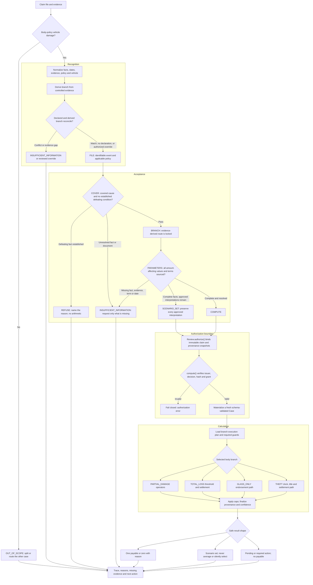

# Body Model: Flow, Acceptance, Recognition, and Calculation Patterns

Status: research and adjuster decision support; not an unattended payment
authority.

This document is the short operational map of the body model. It explains four
separate questions:

1. **Recognition:** what kind of claim does the evidence describe?
2. **Acceptance:** is the file complete and supported enough to calculate?
3. **Calculation:** which authorized branch plan and operators may run?
4. **Result:** may the system issue one payable, several scenarios, or no amount?

Recognition is not acceptance, and acceptance is not a payable. The detailed
questionnaire and graph-generated diagrams remain in
[BODY_CASE_REVIEW_MODEL.md](BODY_CASE_REVIEW_MODEL.md); the full legal and
calculation explanation remains in
[BODY_CLAIM_ACCEPTANCE_MODEL.md](BODY_CLAIM_ACCEPTANCE_MODEL.md).
The prioritized bilingual customer explanation is in
[CUSTOMER_FAQ.md](CUSTOMER_FAQ.md), generated from
[`knowledge/customer_faq.json`](../knowledge/customer_faq.json).

## 1. General summary

| Layer | Main question | Output | Must never do |
|---|---|---|---|
| Recognition | What happened, and which body branch fits the evidence? | Derived branch and reconciliation record | Treat a declared label or keyword as proof |
| Acceptance | Are cover, evidence, policy terms, dates, and parameters sufficient? | `COMPUTE`, `SCENARIO_SET`, `REFUSE`, or `INSUFFICIENT_INFORMATION` | Guess a missing fact, term, rate, date, or operator order |
| Authorization | Did an approved review decision bind this exact validated claim? | Immutable `CalculationAuthorization` | Accept a raw payload, mutable `Case`, or reconstructed capability |
| Calculation | What does the selected graph plan produce? | Payable, scenario set, pending state, or required action | Repair intake defects or silently change the branch |
| Finalization | Why is this result defensible? | Rule trace, provenance, confidence, uncertainties, and next action | Hide a blocking uncertainty behind one number |

The supported `v0.1-body-model` scope is `PARTIAL_DAMAGE`, `TOTAL_LOSS`,
`GLASS_ONLY`, and `THEFT`. Third-party liability, Article 8 expansion, insurer
calibration, and unattended production settlement are outside this release.

## 2. End-to-end flowchart

Standalone Mermaid source:
[02_end_to_end_authorized_flow.mmd](diagrams/02_end_to_end_authorized_flow.mmd).

Fine-grained calculation-only Mermaid source:
[03_calculation_fine_grained.mmd](diagrams/03_calculation_fine_grained.mmd).



The only normal edges into arithmetic are `COMPUTE` and `SCENARIO_SET`, both
through `Review.authorize()`. `REFUSE` and `INSUFFICIENT_INFORMATION` cannot
produce a calculation authorization.

## 3. Recognition pattern

Recognition answers “what is this?” without deciding “what is payable?”

### 3.1 Recognition steps

| Step | Pattern | Result |
|---|---|---|
| Scope | Confirm insured-vehicle body damage under a body policy | `BODY_ONLY` or `OUT_OF_SCOPE` |
| Normalize | Parse event/policy dates, vehicle, cause, damage, theft type, evidence, and endorsements | Schema-valid facts with unknowns kept explicit |
| Derive | Apply controlled evidence and branch precedence | Evidence-derived canonical branch |
| Reconcile | Compare any declared branch with the derived branch | `MATCH`, `CONFLICT`, `INSUFFICIENT_EVIDENCE`, or `AUTHORIZED_OVERRIDE` |
| Hand off | Continue only with a selected branch and auditable basis | Classification record in review and authorization provenance |

### 3.2 Branch-recognition order

```text
whole-vehicle theft
  -> THEFT
attempted-theft damage
  -> PARTIAL_DAMAGE
partial-parts theft
  -> endorsement terms required before amount calculation
repair + replacement + threshold rescue strictly above 75% of event-day value
  -> TOTAL_LOSS
independent glass breakage with the applicable endorsement
  -> GLASS_ONLY
otherwise
  -> PARTIAL_DAMAGE
```

Important boundaries:

- Exactly 75% is not total loss; the test is strictly greater than 75%.
- Glass damaged with another covered event belongs to `PARTIAL_DAMAGE`.
- A declared branch does not override contradictory evidence.
- `AUTHORIZED_OVERRIDE` must retain actor, reason, time, and supporting source.
- Current glass/base-peril recognition still contains limited free-text signals;
  the release roadmap requires replacing them with controlled evidence.

## 4. Acceptance pattern

Acceptance uses the fixed sequence `FILE -> COVER -> BRANCH -> PARAMETERS ->
ISSUE`. A later gate cannot repair a failed earlier gate.

| Gate | Pass condition | Failure pattern |
|---|---|---|
| `FILE` | Identifiable event, relevant dates, policy/version, vehicle, driver, and territory | Request the missing fact or document |
| `COVER` | Policy in force, supported causal event, resolved exclusions, required endorsement identified | `REFUSE` only for an established defeating fact; otherwise insufficiency |
| `BRANCH` | Evidence-derived branch reconciles with the declaration | Stop on conflict/evidence gap unless an auditable override exists |
| `PARAMETERS` | Every amount-affecting value, date, franchise, cap, order, disposition, and source is locked | Insufficiency for missing inputs; scenarios for complete but unresolved law/order |
| `ISSUE` | Exactly one terminal review decision is selected | Never combine a payable with a refusal or blocking uncertainty |

### Terminal review decisions

| Decision | Meaning | Arithmetic? |
|---|---|---|
| `COMPUTE` | Facts and applicable interpretation are complete | Yes; one branch result |
| `SCENARIO_SET` | Facts are complete but multiple sourced interpretations remain | Yes; all approved scenarios |
| `REFUSE` | A coverage-defeating condition is established | No |
| `INSUFFICIENT_INFORMATION` | A required fact, document, date, valuation, or policy term is missing | No |

An uncertainty is not permission to guess. Missing information produces no
authorization; a scenario set is allowed only when the factual and monetary
inputs are complete.

## 5. Authorization and calculation pattern

```text
review answers
  -> review decision
  -> Review.authorize()
  -> immutable claim snapshot + claim hash + immutable provenance snapshot
  -> compute() verification
  -> fresh schema-validated Case
  -> classification reconciliation
  -> graph branch plan + applicable guards
  -> branch-specific operators
  -> caps and finalization
  -> result + trace + provenance + confidence + unresolved variables
```

`compute()` does not accept raw claim JSON or a `Case`. It accepts only a
factory-issued `CalculationAuthorization`. The authorization is bound to the
exact canonical claim snapshot, review decision, issuer, issuance time, and
provenance. This is an enforced in-process architecture boundary, not a claim of
cryptographic protection against hostile interpreter introspection.

### 5.1 Branch calculation patterns

All persisted monetary values are non-negative integer IRR. Toman and
million-toman are presentation conversions only.

#### Partial damage

```text
eligible_parts    = sum(min(assessed_loss, applicable_special_part_cap))
gross_eligible    = labour + eligible_parts
after_depreciation = gross_eligible - replacement_part_depreciation
ratio             = min(1, insured_sum / event_date_market_value)
allowable_rescue  = min(actual_rescue, 20% * sourced_rescue_cap_base)
```

Resolved order:

```text
payable = max(0, after_depreciation - policy_franchise + allowable_rescue)
```

If underinsurance operator order is unresolved, return both approved orders:

```text
ratio first     = max(0, after_depreciation * ratio - franchise + rescue)
franchise first = max(0, (after_depreciation - franchise) * ratio + rescue)
```

#### Total loss

```text
is_total        = repair_and_replacement + rescue_for_threshold
                  > 0.75 * event_date_market_value
settlement_base = min(event_date_market_value, insured_sum)
```

- If the insured keeps the wreck, deduct probable salvage once.
- If the insurer takes title, do not also deduct salvage.
- Apply the sourced franchise and allowable rescue, floor at zero, then enforce
  the insured-sum ceiling.
- Do not apply the underinsurance ratio again after using
  `min(market_value, insured_sum)`.

#### Standalone glass

- Glass caused by a base covered peril routes to `PARTIAL_DAMAGE`.
- Without the standalone endorsement, the route produces zero with
  `NO_STANDALONE_COVER`.
- With the endorsement, glass depreciation is zero; franchise and
  underinsurance behavior remain policy-dependent.
- If endorsement wording or operator order is unresolved, return the approved
  scenario set or request the missing wording.

#### Theft

- Whole-vehicle theft below the sourced 60-day condition returns
  `PENDING_60_DAY_CRITERION`.
- At or above 60 days without title transfer, return
  `TITLE_TRANSFER_REQUIRED`.
- At or above 60 days with title transferred, use the total-loss settlement
  pattern.
- Attempted-theft damage routes to `PARTIAL_DAMAGE`.
- Partial-parts theft requires endorsement limit and franchise terms.

The current stored theft day-count does not itself prove the clock's legal
anchor. Until structured source-backed start/as-of dates are implemented, U13
must block the review handoff rather than allow a guessed clock.

### 5.2 Finalization pattern

Every calculated result must include:

- selected branch, route, variant, and execution-plan identity;
- payable or payable scenarios, never both ambiguously;
- rule and guard trace;
- source, rule, operator, policy, snapshot, and authorization provenance;
- formula, evidence, and authority confidence components;
- live and blocking uncertainties, reason codes, and next action.

The result confidence cannot exceed the weakest amount-affecting dependency or
the evidence-confidence cap bound by review.

## 6. Response pattern

Every caller-facing response should preserve this shape even when no amount is
issued:

```json
{
  "scope": "BODY_ONLY | OUT_OF_SCOPE",
  "decision": "COMPUTE | SCENARIO_SET | REFUSE | INSUFFICIENT_INFORMATION",
  "branch": "PARTIAL_DAMAGE | TOTAL_LOSS | GLASS_ONLY | THEFT | null",
  "classification": {
    "declared": null,
    "derived": null,
    "outcome": null,
    "basis": []
  },
  "missing_information": [],
  "missing_evidence": [],
  "parameters": {
    "resolved": {},
    "unresolved": []
  },
  "calculation": {
    "unit": "IRR | null",
    "payable": null,
    "scenarios": [],
    "operators": [],
    "guards": []
  },
  "provenance": {
    "authorization": {},
    "rules": [],
    "sources": [],
    "policy_documents": []
  },
  "confidence": {
    "formula": null,
    "evidence": null,
    "authority": null,
    "result": null
  },
  "next_action": null
}
```

Lead with the decision, then the reason, then only the next information needed.
Show arithmetic only after acceptance and authorization succeed.

## 7. Practical interpretation

| Situation | Correct model behavior |
|---|---|
| Missing franchise or production year | `INSUFFICIENT_INFORMATION`; never substitute zero |
| Established exclusion or invalid cover | `REFUSE`; identify the provision and run no arithmetic |
| Declared branch conflicts with evidence | Stop unless a documented authorized override exists |
| Complete inputs but unresolved operator order | `SCENARIO_SET`; do not average or choose silently |
| Whole theft with an unsourced clock anchor | Block on U13; do not trust a stored elapsed-day number |
| Valid resolved case | Issue authorization, execute the graph plan, and return a traced result |
| Any blocking uncertainty with one payable | Invalid result; fail the release gate |

In one sentence: **the model recognizes from evidence, accepts through explicit
gates, calculates only from immutable authorization, and reports uncertainty
instead of converting it into false precision.**
