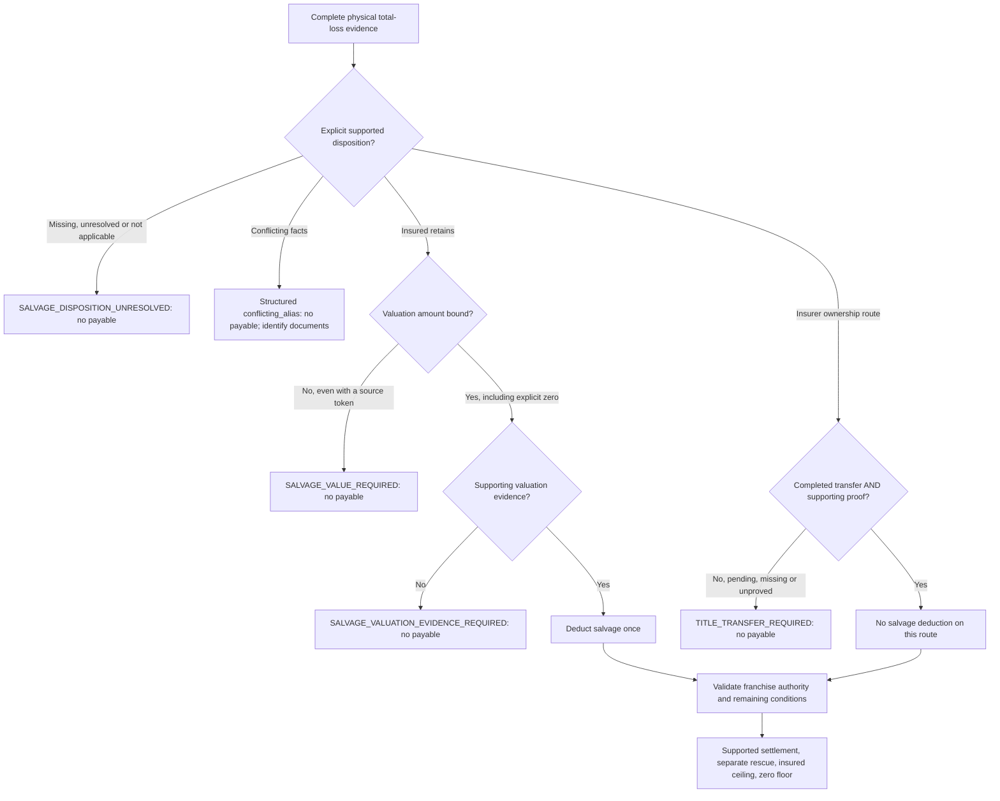
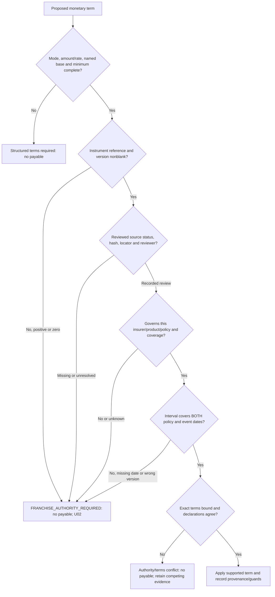
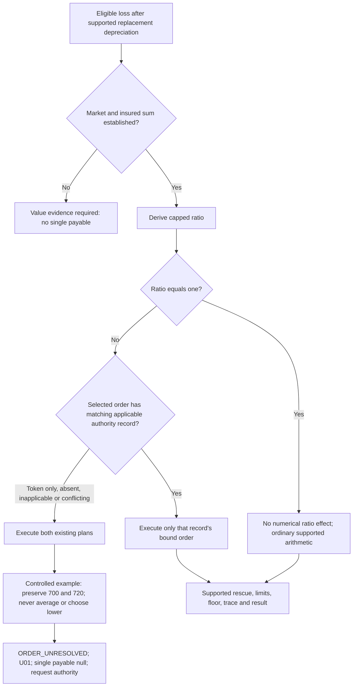

# Settlement evidence and operator sequencing

These are bounded software controls. Synthetic records support regression calculations; real source-review assertions still require external authentication and domain acceptance.

## Physical total loss

This does not impose transfer on every physical loss. Whole theft retains separate classification/time/transfer gates and its established ownership route.

## Franchise authority

A manual's existence is insufficient without governing-contract evidence. Unsupported evidence does not establish that a rate is legally invalid. SYNTHETIC_TEST requires matching synthetic context. VERIFIED is a recorded review attestation, not authentication performed by the calculator.

## Partial loss: Article 10 and franchise

Controlled arithmetic: `(1,000 × .8) − 100 = 700` and `(1,000 − 100) × .8 = 720`, with rescue zero. Equal amounts in another claim do not prove universal legal order; unresolved underinsured equal alternatives remain explicit.
