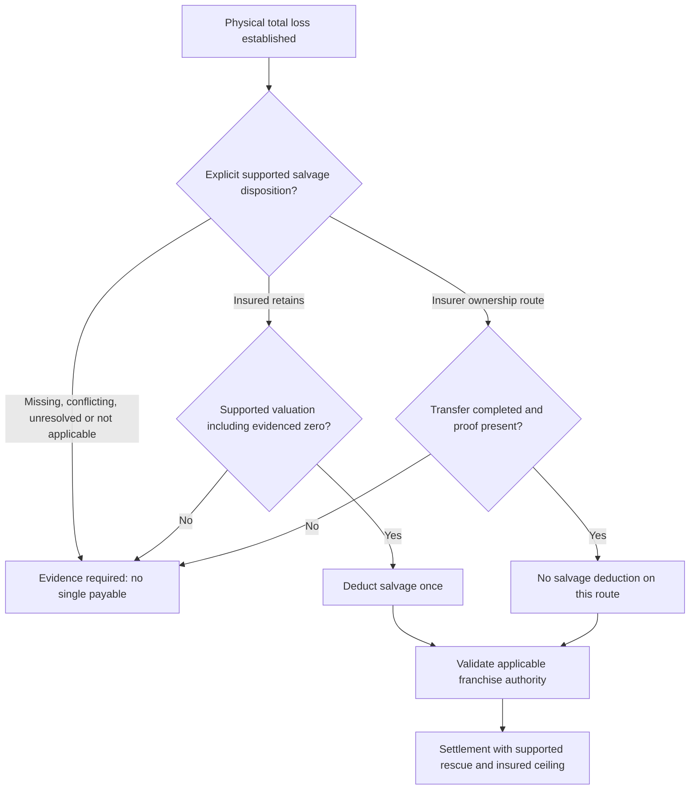
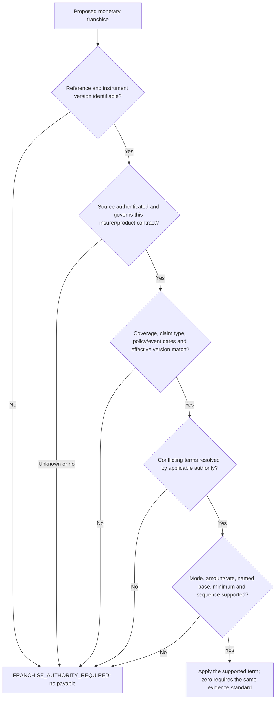
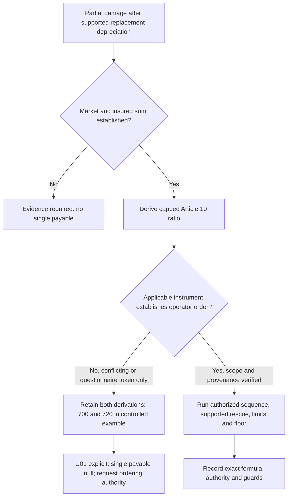

# Settlement authority target flows — work in progress

These are acceptance requirements, not a claim that all gates are implemented.

Ratio one or equal mathematical outcomes do not prove a universal legal sequence. Whole theft retains its separate ownership/time conditions.
