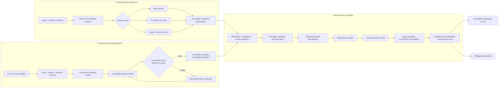

# Research report ↔ executable model validation

**Audit date:** 2026-10-08

**Research baseline:** `Iranian Auto Insurance Claim Calculation Knowledge Graph.md` (as-of 2026-09-18)

**Model baseline:** the current workspace, including the knowledge graph, schemas, review gate, calculation runtime, and 50-case fixture corpus

## Executive verdict

The executable model is a strong structural implementation of the research report, but it is **not yet a validated production implementation of that report**.

The principal architecture is aligned:

- all seven report branches exist;
- the authority hierarchy, uncertainty nodes, contradiction nodes, operators, operator order, and annual-parameter separation exist;
- all 50 report fixture IDs exist in the executable corpus;
- the four body branches use graph-selected calculation plans and fail closed on several unresolved terms;
- the review gate, immutable calculation authorization, guard trace, IRR boundary, and bilingual documentation extend the report in useful ways.

The implementation nevertheless has amount-affecting defects in paths it currently exposes, and several report claims are broader than the implemented scope. The most urgent defects are Article 8 overpayment when actual loss is below the correspondence assessment, causation-required exclusions firing without the required causal fact, incorrect `DEPRECIATE_THEN_CAP` behavior for batteries/tyres, and ignored percentage-franchise base semantics. These are release blockers, not documentation-only gaps.

The report is also not a complete audit artefact. Its final source-register entry is physically truncated, and its `turn...` citation markers are response-local references rather than durable source locators. This audit compares the report's stated rules to the model; it does **not** independently re-verify Iranian law or policy wording against the internet.

## Validation scale

| Status | Meaning |
|---|---|
| `MATCH` | Report requirement exists and the checked runtime behavior agrees. |
| `EXTENDED` | Model adds a useful, compatible control not present in the report. |
| `PARTIAL` | Structure exists, but provenance, scope, or execution is incomplete. |
| `DEFECT` | Current behavior can contradict the report or a declared model invariant. |
| `DEFERRED` | Intentionally outside the currently supported/released scope. |

## Coverage summary

| Area | Finding | Status |
|---|---|---|
| Branch vocabulary | 7/7 canonical report branches are registered. | `MATCH` |
| Shared calculations | 10 operator nodes implement or represent the report's operator families. Liability caps are split by purpose. | `MATCH` |
| Contradictions | The report's 10 topics are present; the model has 13 contradiction nodes. | `EXTENDED` |
| Uncertainties | The report's 10 topics are present; the model adds U11–U15. | `EXTENDED` |
| Synthetic corpus | All 50 IDs are present and `python3 claim.py fixtures` passes 50/50. The model corpus is transformed, not byte-equivalent to the report. | `PARTIAL` |
| Body execution plans | Partial, total loss, glass, and theft bind plan identities and required guards. | `MATCH` |
| Non-body graph execution | Third-party, Article 8, and legal-recovery arithmetic remains hard-coded in `engine.py`. | `PARTIAL` |
| Authority chain | Validation reports no structural graph error, but emits 22 body-authority findings. | `PARTIAL` |
| Source integrity | All 16 sources lack one or more release metadata fields; validation emits 48 findings. | `PARTIAL` |
| Review/admission | Immutable authorization and fail-closed review decisions materially improve the report blueprint. | `EXTENDED` |
| Domain review coverage | The questionnaire and evidence model are body-centric; they do not fully admit third-party, Article 8, or general legal-recovery cases. | `PARTIAL` |
| Ingestion | Closed submission fields, hierarchy checks, and contradiction discovery exist; writes are not atomic, recursive, or concurrency-safe. | `PARTIAL` |
| Retrieval/product layer | Deterministic graph queries exist; GraphRAG, authenticated API, UI, monitoring, and pilot controls are deferred. | `DEFERRED` |

## Rule and calculation trace

| Report requirement | Current implementation | Result | Required action |
|---|---|---|---|
| Article 10 is `min(1, insured / market)` | `operators.underinsurance_ratio` implements the capped ratio. | `MATCH` | Retain boundary/property tests. |
| Partial-loss ratio/franchise order remains configurable | Two graph scenarios are executed from `branches.json`. | `MATCH` | Calibrate per insurer under P3-03. |
| Replacement-part depreciation begins in production-year index 5, 5% yearly, max 25% | Component operator implements the report formula; glass and lamp glass are exempt. | `MATCH` | Add independent golden examples for date/year boundaries. |
| Battery/tyre cap is 50% of new price; interaction with ageing is unresolved | U04 blocks by default, but configured `DEPRECIATE_THEN_CAP` depreciates once before the cap and a second time afterward. | `DEFECT` | Represent each scenario as a complete expression/result, not a shared `base + depreciation` pair. Add a case where the two orders produce different amounts. |
| Franchise source, mode, minimum, calculation base, claim sequence, and coverage line are policy data | Source/mode/rate/minimum are partly enforced. `calculation_base`, `claim_sequence_rule`, and `coverage_specific_rule` are accepted or asked for but not executed. | `DEFECT` | Resolve a typed franchise basis before amount calculation and make it an operand in the plan. Refuse free-text or unsupported bases. |
| Rescue is capped at 20% of a configured gross-damage denominator | Operator is correct; review can bind three denominator choices. Direct runtime defaults to `ASSESSED_GROSS` when the unresolved choice is absent. | `PARTIAL` | Require the denominator when rescue is positive; keep defaults only inside explicitly normalized legacy fixtures. |
| Total-loss test is strict `> 75%` including rescue | Operator and boundary behavior agree. | `MATCH` | Preserve equality and one-IRR-above tests. |
| Total-loss base is `min(market, insured)` and must not receive the ratio twice | Implemented and guarded. | `MATCH` | Add the guard to non-body plan parity only if the scope expands. |
| Salvage precedes franchise; title transfer and salvage deduction are exclusive | Implemented for total loss. `NOT_APPLICABLE` currently falls through to the salvage-retained calculation path. | `PARTIAL` | Require an explicit settlement disposition for total loss and give every enum token one non-overlapping meaning. |
| Standalone glass requires endorsement wording; no universal 20% franchise; depreciation is zero | Base behavior and guards agree. | `MATCH` | Complete U03/U11/U14 adapter data before deterministic standalone-glass release. |
| Whole theft becomes total at 60 days with title transfer | Threshold and title-transfer gates exist. | `PARTIAL` | Replace `days_vehicle_missing` with start event/date, as-of date, calendar, and derived duration. Require integer days and resolve U13. |
| Ordinary third-party payment is bounded by actual loss and policy limit | Implemented. | `MATCH` | Add a domain-specific admission schema and review flow. |
| Article 8 payment must not exceed actual damage, corresponding damage, or the policy limit | The report pseudocode and runtime both use `min(corresponding, policy_limit)`. Runtime also uses `actual_damage or corresponding`; explicit zero and actual loss below correspondence can overpay. | `DEFECT` | Correct both report and model: use `actual = corresponding only when actual is None`; then `payable = min(actual, corresponding, policy_limit)`. Recalculate every residual from the same bounded values. |
| Article 8 correspondence is an expert/component assessment, not a whole-car ratio | Whole-car ratio is refused; missing correspondence blocks. | `MATCH` | Add governed assessment identity, version, assessor, date, component rows, and confidence under P3-05. |
| Legal recovery uses legal loss, statutory cap, prior compensation, then allocation/subrogation | Current branch only computes a body-insurer subrogation ceiling from `body_insurer_paid`. | `PARTIAL` | Split `LEGAL_RECOVERY` into declared modes and implement the report's legal-loss/prior-compensation path separately from body subrogation and TP regress. |
| Causation is a predicate, never a multiplier | No multiplier exists. However `EX_INTOXICATION` can match a bare cause token even when `causation_required` is true and the causal flag is absent. | `DEFECT` | Compile exclusion predicates with `all`/`any` semantics; a causal exclusion must require both the condition and competent causal finding. |
| Endorsable exclusions can proceed when a valid endorsement supplies terms | The gate distinguishes the two exclusion states, but an endorsable exclusion with an endorsement always returns `ENDORSEMENT_TERMS_REQUIRED`; it never consumes supplied terms. | `PARTIAL` | Introduce a versioned endorsement adapter and only block when a required term is absent. |
| A live blocking uncertainty cannot coexist with a single payable | Engine-local uncertainties are guarded. Review-authorized live uncertainties are recorded in authorization provenance but are not all imported into `CalcResult.blocking_uncertainties`. | `DEFECT` | Bind the authorization's live uncertainty set to the calculation, require an explicit runtime resolution for each, and compare resolved IDs at finalization. |

## Architecture trace

| Report architecture | Model state | Gap / decision |
|---|---|---|
| Source-class hierarchy | Six ranked source classes exist. | Keep; complete two-person review and effective intervals. |
| Provenance envelope on every executable node | Rules and sources have linked provenance; result provenance is rule-centric. | Include annual parameters, policy terms, classifier inputs, evidence/valuation artefacts, uncertainty resolutions, and operator versions. |
| First-class `PolicyVersion` and `InsurerProcedure` | Mostly strings and source placeholders. | Add immutable versioned nodes before insurer calibration. |
| First-class evidence and valuations | Evidence types exist, but a case records booleans rather than document/assessment instances. | Add `EvidenceArtifact` and `ValuationArtifact` instances with issuer, date, locator/hash, reviewer, and effective scope. |
| First-class corresponding Article 8 component | Represented as an aggregate input and a generic mapping edge. | Add assessment and component-row entities; preserve the aggregate as a derived value. |
| Operator order as data | Body sequences are graph-selected. | Extend the same plan compiler to the other three branches. |
| Uncertainty as queryable data | 15 nodes exist. Liveness is partly hard-coded in `Review.uncertainty_is_live`. | Store liveness as validated predicates and evaluate one shared predicate language. |
| Contradiction-first ingestion | Scalar shared-key conflicts are detected. | Add recursive semantic comparison, explicit amendments, and reviewer decisions. |
| Versioned annual parameters | 1405 nodes and derived values exist. | Replace secondary diyah evidence and add an atomic annual refresh/revalidation workflow. |
| Expand without breaking | Loader validates many references. Ingestion writes three files sequentially. | Stage a complete candidate graph, validate it, then atomically replace under a repository lock. |
| Explanation with trace/confidence | Result has rule trace, provenance, formula/evidence confidence, guards, and authorization. | Derive confidence from every amount/eligibility dependency; do not omit annual/assessor/policy confidence. |
| Human escalation | CLI review returns compute/scenario/refuse/insufficient decisions. | Add domain-specific review procedures and later an authenticated adjuster workflow. |

## Source, schema, and corpus findings

### Source integrity

`python3 claim.py validate` currently reports:

- 22 body operator/authority findings, including three operator branch-scope mismatches, mirror-host dependencies, and missing reviewers;
- 48 source-integrity findings: content hashes, complete effective intervals, and revalidation dates are absent across the 16 source records.

These are deliberately non-blocking in the current validator. They must become release-blocking for the affected supported scope after the authority pack is populated.

The report needs its own repairs:

1. restore the truncated final source entry;
2. replace response-local citation markers with stable source IDs and clause locators;
3. give the report a version/hash and map that version to the structured source/rule snapshot;
4. incorporate the model's later U11–U15 findings or state that the report is an older baseline;
5. correct the Article 8 pseudocode to apply the actual-loss ceiling and distinguish explicit zero from missing;
6. document every fixture transformation, not only the L49 spelling correction;
7. replace the phrase "production-grade" with a qualified target-state description until primary-source and calibration gates pass.

### Claim and evidence contracts

The repository schema correctly adds `additionalProperties: false`, IRR-only persistence, aliases used by legacy fixtures, and several conditional requirements. It is still too permissive as a single cross-domain admission contract:

- only `claim_id` and `unit` are universally required;
- event dates are plain strings in the claim schema while snapshot resolution expects Jalali `YYYY/MM/DD` or falls back to the supplied Iranian year;
- `days_vehicle_missing` is a number and is truncated with `int()`, rather than being validated as an integer derived from dates;
- cause/peril remain free strings at the calculation boundary;
- evidence presence is stored as booleans, not immutable evidence records;
- caller-supplied classification overrides are documented objects, not role-authorized signed review decisions.

Use a small common envelope plus branch/domain-specific schemas. Normalized calculation input should not contain the report's legacy aliases; keep those in a one-way fixture/import adapter.

### Fixture parity

All 50 IDs are present and currently pass. The executable corpus intentionally converts million tomans to integer IRR and corrects the L49 spelling error. It also makes undocumented semantic changes:

- adds production/claim years to itemized depreciation cases;
- adds repair evidence to total-loss settlement fixtures that omitted the threshold inputs;
- adds theft type to total-theft aliases;
- changes G26 to the canonical `PARTIAL_DAMAGE` branch;
- changes T17 from a direct strict-threshold assertion to `CLASSIFICATION_CONFLICT`.

These are mostly safety improvements, but only the L49 spelling correction is listed in `corrections_applied`. Add a machine-readable transformation manifest and keep an independent report-oracle layer so normalization cannot silently rewrite expected behavior.

## Prioritized fix register

### P0 — fix before describing any affected path as calculation-ready

| ID | Fix | Existing issue coverage | Implementation acceptance |
|---|---|---|---|
| RMV-001 | Apply the Article 8 actual-loss ceiling and preserve explicit zero. | P0-04 | `min(actual, corresponding, limit)` for zero/below/equal/above boundary cases; all residual fields reconcile to actual loss. |
| RMV-002 | Enforce causation-required exclusion predicates. | Promote/add under P2-01/P2-03 | A bare intoxication/drug token without competent causal confirmation cannot deny; confirmed-and-causal still denies. |
| RMV-003 | Correct battery/tyre scenario execution. | Promote amount defect under P3-06 | `CAP_THEN_DEPRECIATE`, `DEPRECIATE_THEN_CAP`, and `CAP_ONLY` use independent formulas and differ on a discriminating case. |
| RMV-004 | Execute or refuse percentage-franchise base semantics. | Promote amount defect under P3-02 | Every percentage franchise has a typed supported base; changing the base changes or invalidates the plan as expected. |
| RMV-005 | Reconcile authorization uncertainties with engine output. | P2-03 / P1-04 | Every live uncertainty is either resolved by a bound artefact or appears in the result; no authorized scenario decision collapses silently. |
| RMV-006 | Fail closed on unresolved body economic inputs at the shared boundary. | P0-03 / P2-01 | Missing ratio anchors, rescue denominator, total-loss disposition, or depreciation dates cannot acquire a benign arithmetic default outside the legacy fixture adapter. |

### P1 — required for the one-week body-model authority gate

| ID | Fix | Existing issue coverage | Implementation acceptance |
|---|---|---|---|
| RMV-007 | Complete the primary authority pack and source hashes. | P1-01, P1-05 | Two reviewers; clause locators; artifact hashes; retrieval/effective/revalidation dates; mirror status explicit. |
| RMV-008 | Make regulatory, policy, and theft-clock snapshots genuinely effective-dated. | P1-02 | Event/policy dates choose exactly one applicable version; invalid/ambiguous clocks block. |
| RMV-009 | Complete dependency-derived provenance/confidence. | P1-04 | Every eligibility/amount input and selected parameter contributes identity, source, confidence, and snapshot version. |
| RMV-010 | Close body taxonomies and remove calculation-boundary text heuristics. | P2-01 | Closed perils/causes/evidence/override types; no `_looks_like_glass` keyword route in normalized input. |
| RMV-011 | Reconcile operator branch scope and graph authority. | P2-02 | Zero 22 authority findings; declared operator scope equals composition or has an explicit non-executing applicability relation. |
| RMV-012 | Expand mutation/property coverage to the discovered defects. | P2-04 | Mutants cover actual-loss cap, causal conjunction, battery order, franchise base, and authorization uncertainty carry-through. |

### P2/P3 — scope completion and calibration

| ID | Fix | Existing issue coverage | Implementation acceptance |
|---|---|---|---|
| RMV-013 | Complete domain-specific admission and review for TP, Article 8, and legal recovery. | Add to P2-01 / P5-01 | No non-body branch relies on the body questionnaire or fixture-only authorization. |
| RMV-014 | Split and complete legal-recovery modes. | New issue recommended | Court/expert legal loss, prior indemnity, statutory cap, body subrogation, multiple-insurance contribution, and TP regress are distinct plans. |
| RMV-015 | Add governed policy/endorsement/insurer adapters. | P3-01–P3-04 | Signed product/version package with typed franchise and endorsement terms plus five approved worksheets. |
| RMV-016 | Add governed Article 8 assessment artefacts. | P3-05 | Assessor identity, component mappings, reference vehicle/set, assessment date, and aggregate derivation are replayable. |
| RMV-017 | Make ingestion transactional and recursively contradiction-aware. | P4-03 | Candidate graph validates before commit; injected failure and concurrent-writer tests prove no partial state. |
| RMV-018 | Build independent golden validation and replay. | P4-01, P4-02 | Report fixtures, transformed fixtures, and anonymized reviewed claims are separate corpora with pinned snapshots. |

## Target architecture

### Architectural implementation rules

1. **One normalized contract per domain.** A common claim envelope holds identity, event, policy, and evidence references. Body, TP/Article 8, and legal-recovery payloads use separate conditional schemas.
2. **Facts are not evidence booleans.** Amount-affecting facts point to immutable evidence or valuation artefacts. Presence can be derived; identity cannot be reconstructed from `true`.
3. **Plans own order and operand bases.** A plan step receives typed operands including the chosen base. Python implements operator semantics but does not choose a hidden order or base.
4. **Authorization owns unresolved state.** The authorization freezes facts, snapshots, approved overrides, and live uncertainties. Finalization proves the engine surfaced or resolved the same set.
5. **Every result is dependency-derived.** Provenance and confidence walk the actual execution DAG: classification facts, sources, policy terms, parameters, assessments, operators, guards, and uncertainties.
6. **Knowledge changes are transactions.** Build and validate a complete candidate snapshot, atomically publish it, and retain the predecessor for rollback and replay.

## Practical implementation sequence

The deterministic defect repair can fit inside the existing body-model sprint; legal certification and insurer calibration cannot.

1. **Safety patch:** RMV-001 through RMV-005, with failing regression tests written first.
2. **Boundary hardening:** RMV-006, domain schema split, integer/date/enum normalization, and legacy-fixture adapter isolation.
3. **Authority completion:** RMV-007 through RMV-009; change source findings to release failures only after records are populated.
4. **Graph completion:** RMV-010 through RMV-012; remove branch-scope findings and hard-coded uncertainty liveness.
5. **Scope honesty:** either implement RMV-013/RMV-014 or mark non-body/general legal recovery as experimental and unavailable through production admission.
6. **Calibration and certification:** RMV-015 through RMV-018, followed by the private shadow pilot and controlled release phases in `docs/ROADMAP.md`.

## Reproducible evidence from this audit

| Check | Result |
|---|---|
| `python3 claim.py validate` | Graph structurally OK; 22 body-authority and 48 source-metadata findings. |
| `python3 claim.py fixtures` | 50/50 pass. |
| Article 8 diagnostic | Actual loss `0`, corresponding `80`, limit `200` returned `80`; actual `50` also returned `80`. Confirms RMV-001. |
| Causation diagnostic | Cause token `INTOXICATION` without causal confirmation returned zero/non-compensable. Confirms RMV-002. |
| Battery/tyre diagnostic | On a discriminating input, configured `DEPRECIATE_THEN_CAP` produced net `56.25` instead of the one-pass `75`; confirms RMV-003. |
| Full pytest suite | Not run in this workspace because the available Python environments do not contain `pytest`; do not infer a current full-suite pass from this audit. |

## Release conclusion

The model is a useful and unusually well-structured research/adjuster system. It should remain labelled **decision support, not unattended payment authority**. The body architecture can reach an internally defensible release after the P0 defects and authority pack are closed. Third-party, Article 8, and legal recovery need domain-specific admission, plan authority, and calibration before they should share that release claim.
